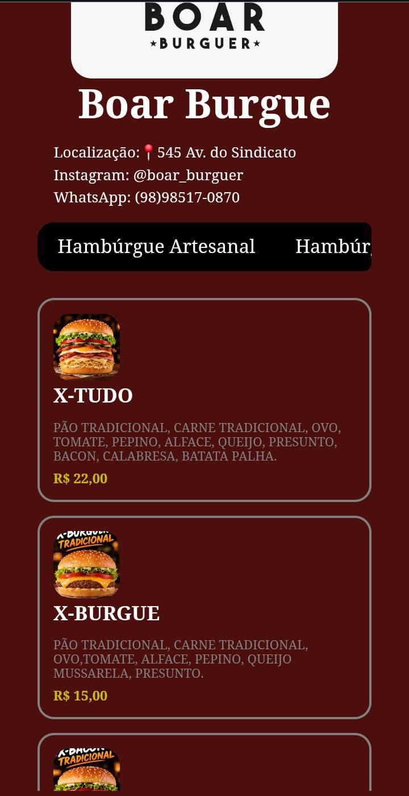
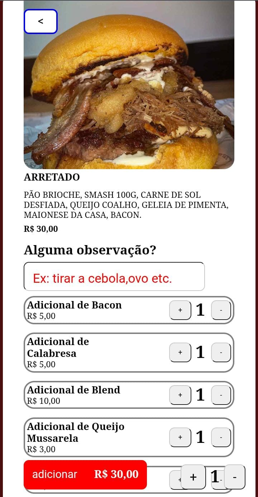
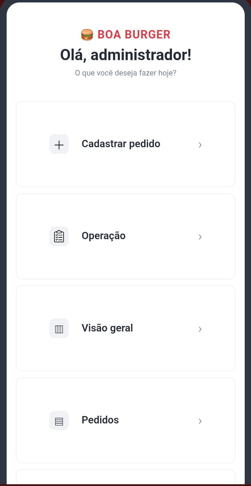
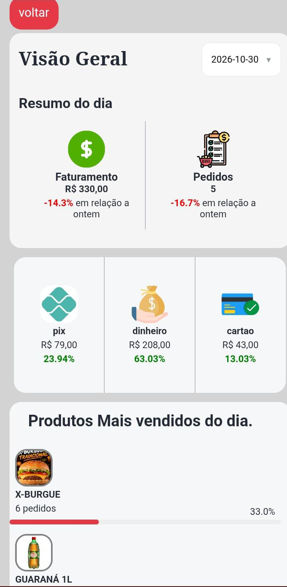
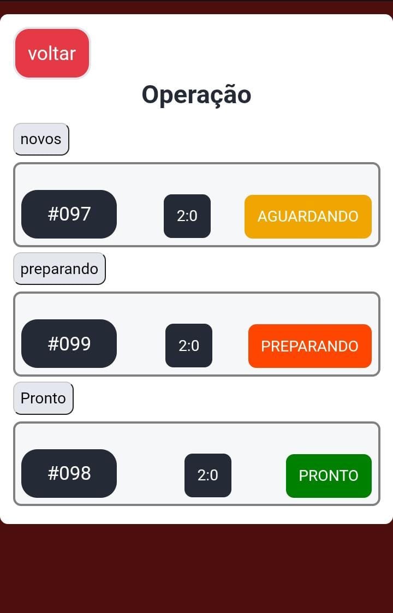

# Cardápio digital - Boar-Burgue

Cardápio online para lanchonete: cliente monta o pedido pelo site e ele é enviado pelo WhatsApp. Inclui um painel para o dono acompanhar as vendas.

## imagens interface do cliente

<table align="center">
    <tr>
        <td valign="top"> 
Interface inicial do Cliente
</td>
        <td valign="top"> 
Descricao do Pedido
</td>    
    </tr>
</table>

## imagens interface admin

<table align="center">
    <tr>
        <td valign="top"> 
Painel admin
</td>
        <td valign="top"> 
Interface Visão geral
</td>
        <td valign="top"> 
Interface Operação
</td>
    </tr>
</table>

## Funcionalidades

- Escolha de produtos, adicionais e observações
- Entrega ou retirada, e forma de pagamento
- Pedido enviado pelo WhatsApp e salvo no banco de dados
- Painel do admin com login: pedidos, status, faturamento por dia,
  produtos mais vendidos e edição do cardápio

## Tecnologias

HTML, CSS e JavaScript puro · Supabase (banco, login e imagens) · Netlify

## Como rodar

1. Baixe ou clone o repositório
2. Abra a pasta no VS Code
3. Inicie com a extensão Live Server

## O que aprendi

- Consumir uma API com fetch e async/await
- Métodos HTTP: POST, GET e PATCH.
- Modelar tabelas relacionadas no banco de dados

## Autor

Otávio Pinheiro Viveiros · [linkedIn](https://www.linkedin.com/in/otávio-pinheiro-viveiro-546874373)
